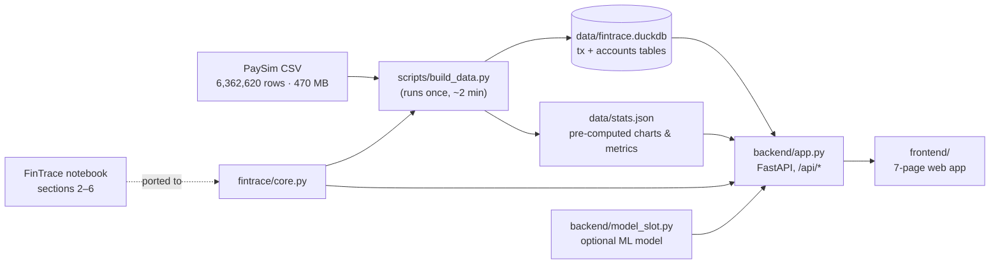
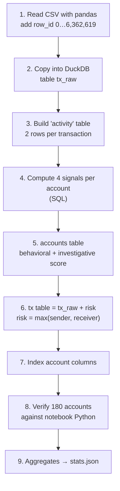
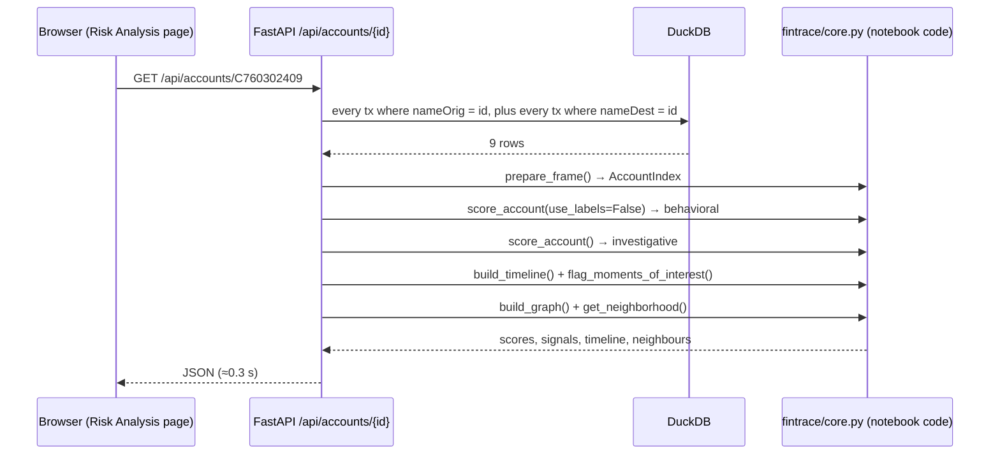

# How FinTrace Fraud Monitor works

This document explains what happens between the raw PaySim CSV and the
numbers on screen: how the data is prepared, how a risk score is
calculated, how the API and web pages fit together, and how the results
are evaluated. All example numbers come from the real dataset.

**Contents**

1. [The big picture](#1-the-big-picture)
2. [Stage 1: building the data store](#2-stage-1-building-the-data-store)
3. [Stage 2: the risk score](#3-stage-2-the-risk-score)
4. [Stage 3: the API](#4-stage-3-the-api)
5. [Stage 4: the web pages](#5-stage-4-the-web-pages)
6. [How performance is measured](#6-how-performance-is-measured)
7. [Plugging in an ML model](#7-plugging-in-an-ml-model)
8. [Limitations](#8-limitations)
9. [File map](#9-file-map)

---

## 1. The big picture

The system has four stages. The heavy work happens **once**, offline, so
every page afterwards loads in about 0.2–0.3 seconds.



| Stage | What it does | When it runs |
|---|---|---|
| 1. Build | Loads the CSV, scores every account, computes aggregates | Once, by hand |
| 2. Score | The notebook's explainable rules (`score_account`) | In bulk at build time, and live per request |
| 3. API | Answers questions from the browser with SQL + notebook code | While the server runs |
| 4. UI | Shows dashboards, tables, charts and forms | In the browser |

The project uses **two copies of the same scoring logic**:

- **The notebook's Python code** (`fintrace/core.py`), used live when you
  open one account or transaction. It is easy to read and explain.
- **A SQL version of the same rules** (`scripts/build_data.py`), used once
  to score all 9,073,900 accounts in about a minute. Looping over that many
  accounts in Python would take hours.

The build checks that the two copies agree (see [2.5](#25-verification)).

---

## 2. Stage 1: building the data store

```bash
python scripts/build_data.py "path\to\PS_20174392719_1491204439457_log.csv"
```

The build runs these steps, logging each one as it goes:



### 2.1 Row IDs

Each transaction gets `row_id` = its position in the CSV. Its display ID
`TXN00000002` is the same ID the notebook's `load_transactions()` would
assign, so IDs on the website match IDs in the notebook.

### 2.2 The activity table: one account, both directions

The notebook treats **accounts** as the unit of investigation, not single
transactions. An account's history is everything it **sent** plus
everything it **received**. So each transaction becomes two rows:

| acct | counterparty | direction | amount |
|---|---|---|---|
| sender | receiver | outgoing | 181.00 |
| receiver | sender | incoming | 181.00 |

That gives 12.7 million activity rows. Every per-account statistic (mean,
standard deviation, quartiles, "first time seeing this counterparty") is a
`GROUP BY acct` or a window function over this table.

### 2.3 The two tables the app uses

| Table | Rows | Key columns |
|---|---|---|
| `tx` | 6,362,620 | all original PaySim columns + `row_id`, `risk_orig`, `risk_dest`, `risk` |
| `accounts` | 9,073,900 | `account_id`, `n`, `w_zscore`, `w_iqr`, `w_novelty`, `w_labels`, `behavioral_score`, `investigative_score` |

Indexes on `nameOrig`, `nameDest` and `account_id` make account lookups
fast.

### 2.4 stats.json

Charts that summarise the whole dataset would need full-table scans on
every page load, so they are computed once instead:

- headline counts (total, labeled fraud, fraud rate, fraud amount, suspicious)
- breakdowns by type, by hour (743 steps), by day, by hour of day, by amount range
- four balance-behaviour patterns (e.g. "amount equals sender's full balance")
- risk-score distributions, plus the 50 highest-scoring accounts
- the full evaluation: confusion matrices for every threshold 0–100

`python scripts/build_data.py --stats-only` rebuilds just this file.

### 2.5 Verification

The build samples 180 random accounts (60 with one transaction, 60 with
4–60 transactions, 60 touching fraud). It then re-scores each one with the
notebook's original Python `score_account()` and compares the result with
the SQL score. On the full dataset the result was **180 checked,
0 mismatches**. That is the evidence that the bulk SQL scores really are
the notebook's algorithm.

---

## 3. Stage 2: the risk score

The score comes from the notebook's section 5, *Explainability*. It is a
sum of four signals, capped at 100. Each signal measures how unusual an
account is **compared with its own history**, not against a global
threshold.

| # | Signal | Measures | Weight formula | Max |
|---|---|---|---|---|
| 1 | `amount_zscore` | share of the account's transactions with \|z\| ≥ 2.5, where z = (amount − account mean) ÷ account std | share × 100 | 40 |
| 2 | `iqr_outliers` | share of amounts outside [Q1 − 1.5·IQR, Q3 + 1.5·IQR] (needs ≥ 4 transactions) | share × 60 | 25 |
| 3 | `counterparty_novelty` | of the last 5 transactions, the share made with a counterparty never seen before; only counts if ≥ 40% | share × 30 | 20 |
| 4 | `labeled_fraud` | number of the account's transactions already labeled `isFraud = 1` | count × 15 | 35 |

### 3.1 Two versions of the score

| Score | Signals | Used for |
|---|---|---|
| **Behavioral** | 1 + 2 + 3 | Classification, alerts, risk bands, every evaluation metric |
| **Investigative** | 1 + 2 + 3 + 4 | Shown as a secondary number. It is the notebook's default |

Signal 4 reads the answer key. If it were used to *predict* fraud and the
predictions were then *checked* against the same labels, the results would
look good without proving anything. So everything that classifies or gets
evaluated uses the behavioral score.

### 3.2 From account score to transaction score

A transaction involves two accounts, so:

```
transaction risk = max(behavioral score of sender, behavioral score of receiver)
```

| Risk | Band | Engine verdict |
|---|---|---|
| 0 – 24.9 | Low | Legitimate (no strong anomaly signals) |
| 25 – 49.9 | Medium | Legitimate (no strong anomaly signals) |
| 50 – 100 | High | **Potentially fraudulent** → raises an alert |

The notebook has a fourth band, Critical (≥ 75). The website folds it into
High, because the brief asked for three bands.

### 3.3 Worked example: a High-risk account

Account **C760302409** received 9 transactions:

| Step | Type | Amount |
|---|---|---|
| 18 | CASH_OUT | 422,181.67 |
| 20 | CASH_OUT | 177,423.35 |
| 33 | CASH_IN | 191,813.80 |
| 37 | CASH_IN | 203,242.36 |
| 38 | CASH_IN | 171,912.60 |
| 256 | CASH_OUT | 28,095.77 |
| 352 | TRANSFER | **1,767,961.22** |
| 522 | CASH_OUT | 250,571.69 |
| 565 | CASH_IN | 16,629.95 |

- **Signal 1:** only the 1.77M transfer is more than 2.5 standard
  deviations from this account's mean. 1 of 9 = 11.1% → 0.111 × 100 =
  **+11.1**.
- **Signal 2:** 4 of the 9 amounts (422K, 28K, 1.77M and 16.6K) fall
  outside the fences Q1 − 1.5·IQR and Q3 + 1.5·IQR, with Q1 = 171,913 and Q3 = 250,572. 44% × 60 = 26.7, which is capped at **+25.0**.
- **Signal 3:** the last 5 transactions all come from senders this account
  had never seen before. 100% × 30 = 30, which is capped at **+20.0**.
- **Signal 4:** no labeled fraud, so +0.

**Total: 56.1, High.** Every transaction into this account gets a risk of at
least 56.1, which is why it shows up in the alert queue. All 9 of its
transactions are labeled legitimate in the dataset, so these are **false
positives**. That is the kind of honest result the Model Performance page
reports.

### 3.4 Worked example: a missed fraud

Transaction **TXN00000002** is a TRANSFER of 181.00 from C1305486145 to
C553264065, and it **is** labeled fraud.

| Account | History | Signals | Behavioral | Investigative |
|---|---|---|---|---|
| C1305486145 (sender) | 1 transaction | novelty 1/1 → +20 | **20.0** | 35.0 (+15 label) |
| C553264065 (receiver) | 44 transactions | z +2.3, IQR +1.4, novelty +20 | **23.6** | 38.6 (+15 label) |

Transaction risk = max(20.0, 23.6) = **23.6, Low**, so the verdict is
"Legitimate". Compared with the label this is a **false negative**. The
Detection Engine shows exactly this comparison when you classify
TXN00000002.

### 3.5 Why most accounts score exactly 20

**8,604,623 of the 9,073,900 accounts (94.8%) appear in only one
transaction.** For such an account:

- Signal 1 is 0, because the standard deviation of one value is 0.
- Signal 2 is 0, because the IQR check needs at least 4 transactions.
- Signal 3 fires: its only transaction is with a new counterparty, so
  1 of 1 = 100%, which is capped at **+20**.

So the typical score is 20, and the per-account signals have very little
history to work with. This is the main reason the rules separate fraud
poorly on PaySim (see [section 6](#6-how-performance-is-measured)).

---

## 4. Stage 3: the API

`backend/app.py` is a FastAPI app. It opens the DuckDB file **read-only**
and serves two things:

- `/api/*`: JSON (and CSV/HTML downloads) for the web pages
- `/`: the static frontend files

### 4.1 What happens when you open an account



The API only fetches the rows that touch this one account and hands them
to the notebook's own classes. The answer is identical to running the
notebook on the full dataset, because `score_account` only ever looks at
those rows.

### 4.2 What happens when you classify a transaction

`POST /api/engine/score` with `{"row_id": 2}`:

1. Look up the transaction.
2. Run 4.1 for the sender and for the receiver.
3. Risk = max of the two behavioral scores. If it is ≥ 50, the verdict is
   "Potentially fraudulent".
4. If an ML model is loaded, also call `model.predict_proba` (see
   [section 7](#7-plugging-in-an-ml-model)).
5. Return everything, plus the dataset's `isFraud` label for comparison.

**Hypothetical transactions** (`{"transaction": {...}}`) work the same way.
The made-up transaction is appended to each party's real history (if the
account exists), both accounts are re-scored, and nothing is saved.

### 4.3 Transaction search

`GET /api/transactions` turns the page's filters into one parameterised
SQL query (`WHERE type IN (...) AND isFraud = ? AND risk >= 50 ...`). It
returns one page of rows plus the total count. The CSV export endpoint uses
the same filter builder, so an export always matches what the table shows.
Sort columns are taken from a fixed allow-list, and every value is passed
as a query parameter, never pasted into the SQL text.

The full endpoint list is in the [README](../README.md#api). Live,
clickable docs are at `http://localhost:8000/docs` while the server runs.

---

## 5. Stage 4: the web pages

The frontend is plain HTML, CSS and JavaScript, with no framework and no
CDN, so it also works offline:

- `index.html`: the shell (sidebar, top bar, an empty `<main>`)
- `js/app.js`: routing, API calls and all seven pages
- `js/charts.js`: a small SVG chart kit (bars and lines with tooltips)
- `css/styles.css`: theme tokens (light/dark), layout and print styles

### 5.1 Routing

The page is chosen by the URL hash, e.g. `#/explorer?type=TRANSFER&fraud=1`.
Changing a filter rewrites the hash, and the router re-renders the page. As
a result, every view (including filtered views) can be bookmarked or shared,
and the browser's Back button works.

### 5.2 Where each page gets its data

| Page | Data source | Computed |
|---|---|---|
| Dashboard | `stats.json` + `/api/transactions?suspicious=true` | at build + live |
| Transaction Explorer | `/api/transactions`, `/api/transactions/export` | live SQL |
| Detection Engine | `POST /api/engine/score` | live notebook code |
| Risk Analysis | `/api/accounts/{id}`, `/api/accounts/{id}/report`, `stats.json` | live notebook code |
| Fraud Analytics | `stats.json` | at build |
| Alerts & Reports | `/api/transactions` (alert filters), export endpoints | live SQL |
| Model Performance | `stats.json` → `evaluation` | at build |

### 5.3 Telling real, rule-based and unavailable apart

The brief required that simulated results never be confused with real
model output. The UI enforces this in three places:

- **Provenance chips** on every page: *Real data*, *Rule-based FinTrace
  engine*, *ML model: not connected*.
- **Source badges** on each dashboard tile: *Dataset*, *Label*, *Rules*.
- **Explicit empty states.** Where an ML result would appear, the page
  says "Not connected / Not available". It never shows a placeholder number.

### 5.4 Charts

Charts are drawn as SVG by `charts.js`:

- thin bars with rounded ends
- 2px lines with a crosshair tooltip
- a legend whenever a chart has two or more series
- a **Table** toggle on every chart, so no value is reachable only by
  hovering

Red always means fraud. Low/Medium/High pills always carry an icon and a
word as well as a colour, so they still read correctly for colour-blind
users or in print.

---

## 6. How performance is measured

Two detectors exist, and both are scored against the dataset's `isFraud`
labels on **all 6,362,620 transactions**. Nothing is sampled.

| Detector | Rule |
|---|---|
| FinTrace (behavioral) | predicted fraud if transaction risk ≥ threshold |
| PaySim `isFlaggedFraud` | the simulator's own built-in flag, already in the CSV |

### 6.1 The threshold sweep

The build counts frauds and non-frauds at every whole-number risk value,
then accumulates from 100 down to 0. That yields the confusion matrix (TP,
FP, FN, TN) for **every** threshold in one pass. The threshold slider on
the Model Performance page just picks one row from this table.

### 6.2 Results

| Detector | Precision | Recall | F1 | Flagged |
|---|---|---|---|---|
| FinTrace, threshold 50 | 0.44% | 0.06% | 0.11% | 1,138 |
| FinTrace, threshold 25 | 0.13% | 36.7% | 0.26% | 2,310,283 |
| PaySim `isFlaggedFraud` | 100% | 0.19% | 0.39% | 16 |

### 6.3 Reading them correctly

- **Accuracy is useless here.** Only 0.129% of transactions are fraud, so a
  "detector" that answers *legit* every time scores 99.87% accuracy. The
  page leads with precision, recall and F1 for this reason.
- **The rules are weak at classification, and that is expected.** They were
  designed to *explain* why an account looks unusual to a human
  investigator, using that account's own history. With 94.8% of accounts
  appearing only once, that history is usually empty.
- **The dataset does contain strong signals; the rules just don't use
  them.** Fraud Analytics shows that when a TRANSFER or CASH_OUT moves the
  sender's *entire* balance, 8,018 of 8,018 cases are fraud. That is a
  descriptive finding, not part of any model, and it is the kind of feature
  a trained classifier would pick up.

---

## 7. Plugging in an ML model

`backend/model_slot.py` is an empty socket for a classifier. At startup it
looks for two files:

| File | Contents | Effect |
|---|---|---|
| `models/model.joblib` | a scikit-learn pipeline taking the columns `step, type, amount, oldbalanceOrg, newbalanceOrig, oldbalanceDest, newbalanceDest` | The Detection Engine shows its fraud probability next to the rule verdict |
| `models/metrics.json` | held-out accuracy, precision, recall, F1, confusion matrix | The Model Performance ML card shows these numbers, labeled as coming from your file |

If the files are missing, `/api/health` reports `available: false` and the
UI says so. The README contains a ready-to-run notebook cell that trains a
model with a time-based train/test split and writes both files.

Only load a model file you created yourself, because joblib/pickle files
can run code when they are opened.

---

## 8. Limitations

- **Hindsight in account scores.** Each account is scored on its *full*
  31-day history, as in the notebook, so a transaction's risk can depend on
  later transactions. That's fine for investigation, but a live system
  would score only on past data.
- **Synthetic data.** PaySim is simulated. Some of its patterns are
  artifacts of the simulation, such as legitimate volume nearly vanishing
  in the last days while fraud continues. Results here won't transfer
  directly to real banking data.
- **No community detection on the full graph.** The notebook's Louvain
  clustering is not run over all 9M accounts. The website shows each
  account's 1-hop neighbourhood instead.
- **Currency.** PaySim doesn't state a currency, so amounts are shown
  without a symbol.

---

## 9. File map

```
fintrace-fraud-monitor/
├── fintrace/
│   ├── core.py               notebook sections 2–6: data layer, graph, timeline,
│   │                         score_account, case report
│   └── case_report.html.j2   the notebook's case-report template, unchanged
├── scripts/
│   └── build_data.py         CSV → DuckDB, bulk SQL scoring, verification, stats.json
├── backend/
│   ├── app.py                FastAPI: /api/* endpoints + serves the frontend
│   └── model_slot.py         optional ML model loader
├── frontend/
│   ├── index.html            app shell
│   ├── js/app.js             router + the 7 pages
│   ├── js/charts.js          SVG bar/line charts
│   └── css/styles.css        theme, layout, print styles
├── notebooks/
│   └── FinTrace_Colab_1.ipynb   the original analysis notebook
├── models/                   drop model.joblib + metrics.json here
├── data/                     generated, not in git (fintrace.duckdb, stats.json)
├── README.md                 setup and API reference
└── docs/HOW_IT_WORKS.md      this document
```
